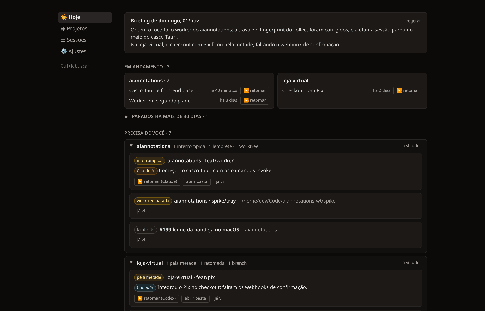
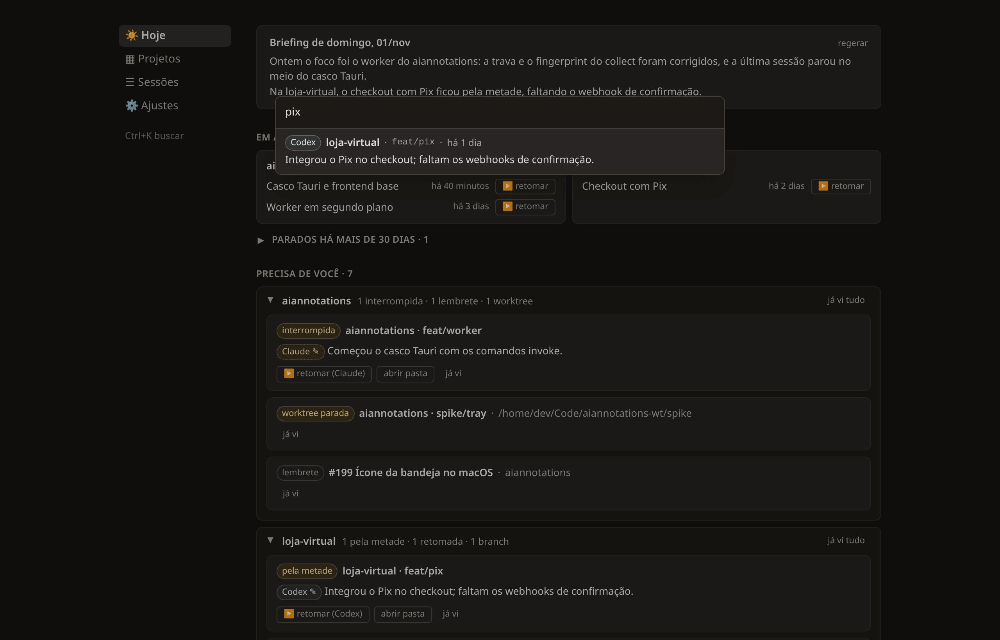
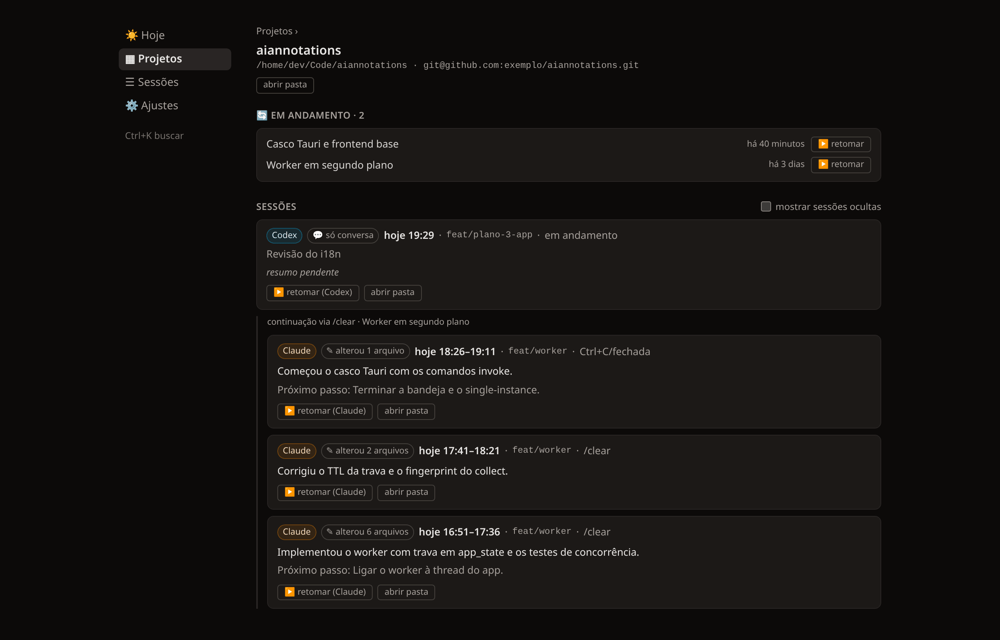
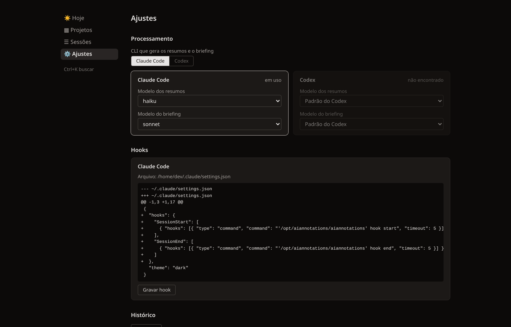
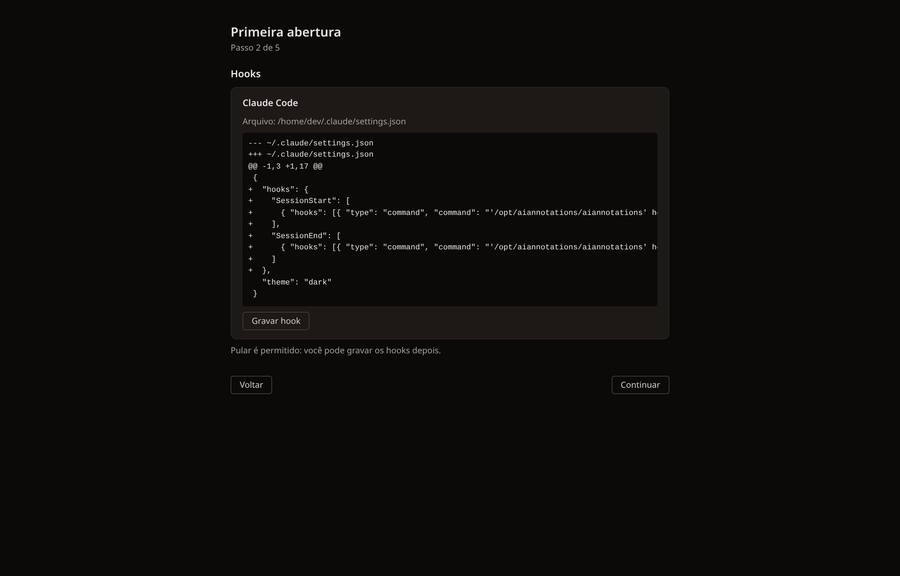

# AIAnnotations

Um companheiro de desenvolvimento para quem trabalha com **Claude Code** e **Codex CLI**.

O AIAnnotations fica na bandeja do sistema e acompanha as suas sessões de IA em todos os projetos: registra o que foi feito em cada uma, resume o trabalho, lembra o que ficou pendente e permite retomar uma sessão pausada com um clique.

> **Status:** beta (v0.1.0). Baixe em [Releases](../../releases) e veja o [INSTALL](INSTALL.md). Sugestões e problemas: abra uma [issue](../../issues/new).

## Recursos

- Registro automático das sessões do Claude Code e do Codex, via hooks dos próprios CLIs.
- Resumos e briefing diário gerados pelo CLI que você escolher (`claude` ou `codex`).
- Visão "Hoje" com sessões recentes, pendências e trabalhos em andamento.
- Retomada de uma sessão com um clique, no CLI em que ela começou: o app copia o comando e abre o terminal rodando-o.
- Lista "abrir com…" para abrir o projeto no seu editor ou terminal.
- Busca em todas as sessões com Ctrl+K.
- Interface em português e em inglês.
- Roda em Windows, macOS e Linux, com consumo baixo de memória.

## Telas

> As capturas usam dados fictícios.

**Hoje.** O briefing do dia, os trabalhos em andamento e o que precisa de você, agrupado por projeto: sessões interrompidas ou pela metade, worktrees paradas, lembretes.

**Busca.** Ctrl+K procura em todas as sessões, em qualquer tela.

**Projeto.** As sessões de um projeto em ordem, com o resumo, o próximo passo e as continuações via `/clear` agrupadas.

**Ajustes.** O CLI que gera os resumos e os modelos de cada um, os hooks, o histórico, o idioma e a pausa. Também os [editores, terminais e o shell](guide/editores-e-terminais.md) usados para abrir projetos e retomar sessões. Cada mudança é salva na hora.

**Primeira abertura.** Um assistente em 5 passos. Os hooks só são gravados depois que você vê o diff do arquivo de configuração e confirma.

## Instalação

Veja [INSTALL.md](INSTALL.md).

## Guias

Documentação de uso em [guide/](guide/).

## Licença

[MIT](LICENSE)
